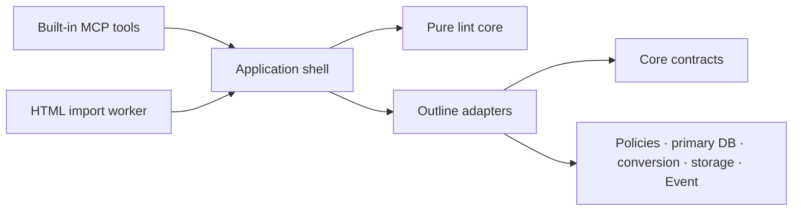

# Architecture Spine — Deterministic Wiki linting for Outline MCP

## Design Paradigm

Use **Functional Core, Imperative Shell** inside the existing Outline monolith.



Dependencies point inward: the core owns deterministic contracts and rule behavior; adapters translate authorized Outline state into those contracts; the application shell owns sequencing, transactions, failure policy, and effects. The core imports no Sequelize model, authorization policy, environment/config singleton, queue, Event, cache, logger, clock, network, or storage implementation.

## Invariants & Rules

### AD-1 — Functional Core, Imperative Shell [ADOPTED]

- **Binds:** all lint and enforcement paths.
- **Prevents:** read-only lint and write enforcement acquiring different rule semantics or effect boundaries.
- **Rule:** MCP handlers and workers call one application shell, which supplies immutable inputs to one pure core. All authorization, database, transaction, timeout, media, audit, and response effects remain outside the core.

### AD-2 — Authorized data boundary [ADOPTED]

- **Binds:** `lint_document`, `lint_wiki`, create/update enforcement, link and hierarchy rules.
- **Prevents:** rule code expanding authority or learning protected target state.
- **Rule:** the core receives only a validated immutable policy, a full `ProjectedDocument` or authorized `WikiSnapshot`, canonical syntax with safe locations, an access-collapsed link map, and an evaluation context/deadline. Existing Outline policies and membership-aware scopes run in adapters. Missing, deleted, and inaccessible targets become the same `unresolved` value before crossing the boundary.

### AD-3 — Closed rule and issue registry [ADOPTED]

- **Binds:** OD-1, configuration, result contracts, fixtures, audit aggregates.
- **Prevents:** per-collection severity drift, client-defined behavior, arbitrary code/regex execution, and issue-code reuse.
- **Rule:** a code-owned discriminated-union registry defines every rule kind, parameter validator, fixed severity, emitted code, and semantic description. Configuration may select registered kinds and parameters only; it cannot provide executable code, arbitrary regular expressions, issue codes, or severity overrides. A material semantic change creates a new code. One code-owned link-extraction function, built on the baseline's URL and document-identifier helpers, serves every surface; the exact recognized forms are fixed by fixtures (D-9).

`Surfaces`: `document` = `lint_document`, the `lint_wiki` document/link unit, and enforced writes; `wiki` = the `lint_wiki` hierarchy and global-index units only; `all` = every surface; `lint_wiki` = the `lint_wiki` snapshot and admission only; `startup diagnostics only` = never in a result. The four hierarchy codes belong to the `hierarchy` check, `GLOBAL_INDEX_LINK_MISSING` to `global_index`, and every other rule code to `documents`.

| Class | Stable code | Location | Surfaces | Fixed meaning |
| --- | --- | --- | --- | --- |
| Error | `REQUIRED_SECTION_MISSING` | `document` | `document` | A configured required section is absent. |
| Error | `SECTION_ORDER_INVALID` | `text` | `document` | Configured sections are present in a forbidden order. |
| Error | `HEADING_LEVEL_NOT_ALLOWED` | `text` | `document` | A heading uses a level outside the configured allowed set. |
| Error | `REQUIRED_METADATA_FIELD_MISSING` | `document` | `document` | A configured visible metadata field is absent. |
| Error | `METADATA_FIELD_FORMAT_INVALID` | `text` | `document` | A visible metadata value fails its registered deterministic format. |
| Error | `MARKDOWN_STRUCTURE_UNSUPPORTED` | `text` | `document` | Canonical Markdown contains a configured unsupported structure. |
| Error | `INTERNAL_LINK_TARGET_UNRESOLVED` | `text` | `document` | A visible internal link cannot be safely resolved for the actor. |
| Error | `PARENT_DOCUMENT_UNRESOLVED` | `relationship` (`parent`) | `wiki` | An evaluated document's parent cannot be safely resolved for the actor. |
| Error | `HIERARCHY_CYCLE` | `relationship` (`parent`) | `wiki` | The authorized hierarchy graph contains a cycle. |
| Error | `PUBLISHED_DOCUMENT_MISSING_FROM_STRUCTURE` | `relationship` (`collection_structure`) | `wiki` | An authorized published document is absent from authoritative collection structure. |
| Error | `PARENT_COLLECTION_MISMATCH` | `relationship` (`parent`) | `wiki` | An authorized parent relationship crosses collections inconsistently. |
| Error | `GLOBAL_INDEX_LINK_MISSING` | `relationship` (`global_index`) | `wiki` | An authorized surface document lacks a direct link to an authorized configured global index. |
| Warning | `DISCOURAGED_MARKDOWN_STRUCTURE` | `text` | `document` | Canonical Markdown contains a configured discouraged, but permitted, structure. |
| System Failure | `POLICY_CONFIGURATION_INVALID` | `scope` | `all` | An identifiable collection policy is invalid or its effective fingerprint cannot be established consistently. |
| System Failure | `POLICY_SCHEMA_VERSION_UNSUPPORTED` | none | startup diagnostics only | The configuration schema version is unsupported; startup-fatal at the root and never returned in a result. |
| System Failure | `POLICY_CONFIGURATION_MALFORMED` | none | startup diagnostics only | The configuration file is unreadable, malformed, or too large, has duplicate or unidentifiable keys at the root or `collections` level, or has any other defect that prevents establishing the v1 envelope; startup-fatal and never returned in a result. |
| System Failure | `VALIDATION_RUNTIME_FAILED` | `scope` | `all` | An unexpected failure occurred inside rule evaluation or an authorized-data read made for validation, or a check could not be proven under the actor's authorization (generic by design, AD-9). Failures of the write's own authorization, locking, transformation, staging, model validation, persistence, or commit are not runtime validation failures (AD-20). |
| System Failure | `VALIDATION_TIMEOUT` | `scope` | `all` | The server-owned deadline expired during `lint_wiki` or `lint_document` snapshot construction or unit evaluation, or during an enforced write's P5 after P5 began; or its remainder fell below the code-owned floor before a P5 related-state batch after P5 began, or before a `lint_wiki` or `lint_document` snapshot-construction batch; or `lint_wiki` stopped at its stop margin (AD-11). Expiry or a below-floor remainder in the `lint_document` document lookup and document `read` check (AD-10), the AD-16 step-1 lookup, or write phases P2 to P4, P7, and P8 is not this code. |
| System Failure | `VALIDATION_RESOURCE_LIMIT_EXCEEDED` | `scope` | `lint_wiki` | A code-owned resource or concurrency limit was exceeded. |

`POLICY_NOT_CONFIGURED` is a stable `not_evaluated` reason carried in the AD-12 `reason` field, not a System Failure. The registry also owns the stable tool-execution error identifier `collection_conflict` (AD-8).

### AD-4 — Safe locations and deterministic order [ADOPTED]

- **Binds:** all Findings and System Failures.
- **Prevents:** client-visible ordering drift, fabricated source positions, and protected identity leakage.
- **Rule:** locations are exactly `text { documentId, line, column, path? }`, `document { documentId }`, `relationship { documentId, relationshipKind }`, or `scope { scopeKind, collectionId?, documentId? }`, where every `scope` location whose `scopeKind` is `document` carries `documentId`. `relationshipKind` is `parent | collection_structure | global_index`; `scopeKind` is `document | collection | configured_collections`. Line and column are one-based coordinates over the exact string `toMarkdown(document, { includeTitle: false })` with no `commonMark` and no signed URLs, LF being the only line terminator; columns count Unicode code points. One position-producing component supplies coordinates and `path`, an array of string/integer segments; rules never recompute positions. Every identifier present is actor-authorized, and `collectionId` is present only when the actor can read that collection (AD-12). For a create, the projection's pre-allocated document ID (AD-7) is the `documentId` of every location. Relationship locations name the authorized source, never a protected target. Each of `errors`, `warnings`, and `systemFailures` is sorted by authorized collection ID, document ID, line, column, structural path, location-kind rank, issue code, then rule-local ordinal; absent values sort last, except that the collection ID is derived server-side for a location that carries none; strings use bytewise UTF-8 comparison. Location-kind rank is `text` 0, `document` 1, `relationship` 2, `scope` 3. Paths compare segment-wise: integers before strings, integers numerically, strings bytewise, a shorter prefix first. The rule-local ordinal is the zero-based emission index of that rule kind within one document in document order. Ties are broken by emission order, and the collection-ID sort key is derived server-side for locations that carry none. Titles, messages, database order, locale, and timing never affect order.

### AD-5 — Startup-loaded policy configuration [ADOPTED]

- **Binds:** FR-11 through FR-13 and all collection-specific behavior.
- **Prevents:** request-controlled policy, silent partial parsing, and a malformed entry disabling unrelated collections.
- **Rule:** optional `WIKI_LINT_CONFIG_PATH` points to one schema-version-1 JSON file loaded once at startup; there is no watcher or mutation API. An absent path means no Configured Collections. The v1 envelope is exactly `{ schemaVersion: 1, collections: Record<UUID, CollectionPolicy> }`; `CollectionPolicy` requires `activation`, defaults omitted `runtimeFailureMode` to `closed`, and requires a non-empty `rules` array of unique registered kinds whose exact closed parameter schemas live in the AD-3 registry. Unknown fields are invalid at every level. Collection keys must be lowercase canonical 8-4-4-4-12 hexadecimal UUIDs; any other key is unidentifiable. Numbers must be base-10 integers within the JavaScript safe-integer range, written without fraction, exponent, or negative-zero form; keys and strings must not contain unpaired surrogates. A custom duplicate-aware JSON decoder operates on the raw bytes and reports each collection entry's exact source byte span, because stock `JSON.parse` reports neither duplicate keys nor byte spans. Malformed input is any RFC 8259 grammar violation anywhere, a leading byte-order mark, or bytes that are not well-formed UTF-8. Unreadability, malformed input, unsupported root schema, and duplicate keys (compared after JSON unescaping) or unidentifiable keys at the root or `collections` level block startup. After a valid envelope is established, entries validate independently: a valid entry becomes immutable policy; an identifiable entry with any schema defect, a duplicate key nested inside it, an unpaired surrogate, or an out-of-profile number becomes an immutable fail-closed sentinel for that collection; other valid or absent collections remain unaffected. The master process reads the file once, validates it under these rules, computes the policy set and its fingerprint, and passes the exact bytes to every forked worker through an inherited environment variable, the file being limited to 64 KiB (a larger file is malformed input); a worker never reads `WIKI_LINT_CONFIG_PATH`, including after a respawn, and each service's master does this for its own workers.

`activation` is `read_only | enforced`; `runtimeFailureMode` is `closed | open` and defaults to `closed`. Neither is accepted from MCP input.

### AD-6 — Policy identity and lifecycle [ADOPTED]

- **Binds:** responses, audit summaries, rollout evidence, multi-instance consistency.
- **Prevents:** operators or clients comparing policies by mutable labels or raw configuration.
- **Rule:** canonical JSON has no whitespace; recursively sorts object keys by the UTF-8 bytes of their unescaped scalar sequence; preserves array order; rejects lone surrogates and performs no Unicode normalization. Strings escape quote, reverse-solidus, and U+0000–U+001F using the shortest JSON escape (lowercase `\u00xx` when no short escape exists); other scalars are emitted as UTF-8. Integers use base 10 without leading zeroes; booleans are lowercase; null is `null`. `policyFingerprint = sha256:<lowercase-hex>` over canonical UTF-8 `{ schemaVersion, activation, runtimeFailureMode, rules }` in registry-normalized form, with every omitted default materialized. Canonicalization applies to valid entries only. An identifiable invalid entry has `invalidFingerprint = sha256:<lowercase-hex>` over the exact bytes of its JSON value as written in the file, so it is computable for every defect. That span runs from the first to the last byte of the entry's value token, excludes the key, colon, comma, and surrounding whitespace, and hashes interior bytes, including line endings and escapes, verbatim; converting line endings therefore changes an `invalidFingerprint` but never a `policyFingerprint`. An invalid entry exposes only that hash, a stable code, and a JSON-Pointer schema path; the path is operator-only and never appears in a result. `policySetFingerprint` hashes canonical `{ schemaVersion, collections }`, where `collections` is an array sorted by collection UUID and each item is `{ collectionId, status: "valid", policyFingerprint }` or `{ collectionId, status: "invalid", invalidFingerprint }`. An absent `WIKI_LINT_CONFIG_PATH` has the `policySetFingerprint` of the empty set (`collections: []`), which a file containing `{ "schemaVersion": 1, "collections": {} }` also produces. Raw configuration is never returned or logged. A rollout is incomplete until every serving instance reports the expected policy-set fingerprint.

### AD-7 — One side-effect-free Projected Document [ADOPTED]

- **Binds:** MCP `create_document`, `update_document`, templates, HTML import, every edit mode.
- **Prevents:** validation of fragments, validation/persistence drift, and rejected writes leaving visible media or records.
- **Rule:** an enforced write classified under a valid `enforced` policy builds one full `ProjectedDocument` using the baseline's exact template substitution, canonical Markdown/ProseMirror conversion, publish/unpublish behavior, and `replace`, `append`, `prepend`, and `patch` semantics. The validated projection contains final title, body/content/state, collection, parent, publication state, and relationships; persistence stores that projection without reapplying the edit. Implement a new `stage -> project -> validate -> materialize` media protocol: every staged blob is tracked under `invocationId` and written at its final storage key under a pre-allocated Attachment ID, so it stays Outline-inaccessible until that Attachment row commits, and materialization is only the row insertion inside the transaction; no storage I/O runs inside an enforced transaction. Blobs are tracked under `invocationId` and attempt, and Attachment IDs are pre-allocated per attempt, so an attempt deletes only the blobs it staged and never another attempt's. AD-20 rows 2, 3, 4, and 5 delete them idempotently, and so does an attempt that ends on a unique violation of the pre-allocated `documentId`, whose transaction rolled back; row 7 never deletes them. The requester-staged source content belongs to the invocation: the requester deletes it before `queue.add` on a requester-determined row 3, otherwise the worker deletes it when it returns a terminal outcome (`committed`, `rejected`, `conflict`, `aborted`) after its repeated lookup, the baseline conversion code's own delete is disabled for the enforced task, row 7 leaves it (a source so retained that no later attempt consumes is an accepted orphan residual with no cleanup owner), and an attempt whose input is gone is row 3. The stager refuses new blobs after its phase bound or once cleanup has begun. For a create, `documentCreator`'s `id` is pre-allocated at classification and used as the projection's ID: it is the `documentId` of every location, becomes the persisted ID on commit, and appears in no Event column unless the row commits. Client input cannot select this mode.

**HTML import worker.** Enforced HTML creation runs as a distinct registered task with its own class and name that shares the baseline conversion code; the baseline `DocumentImportTask` and its API mode are unchanged. A requester that receives a result without the `EnforcedImportResult` shape reports row 7. The task's intent carries request and invocation IDs, `actorId`, `sourceIp`, the pre-allocated `documentId`, `expectedPolicyFingerprint`, the `readable` flag computed at classification (AD-12), `handlerEnteredAtEpochMs`, `classifiedAtEpochMs`, `deadlineAt` (epoch milliseconds), and the auth envelope `{ credentialAuthType: "api" } | { credentialAuthType: "oauth", authenticatedClientId }`. It carries no access/API token, secret, cookie, authorization header, or client-claimed identity. Document content is passed by staged reference, and an enforced job's props appear in no log line or tracer tag beyond the job ID and task name, at every site (task start, task failure, tracer tags, queue failure).

The worker resolves every found row through one routine, `committedFromSummary(invocationId)`, except after the attempt's own persist decision (a unique violation of the pre-allocated `documentId`), which returns the attempt's own `validation`, and except when the AD-20 commit-detection probe that follows the attempt's own rejected `commit()` finds the pre-allocated `documentId`: the worker may then report its own `validation` as row 6 when the found row's title and `text` equal the title and `text` of this attempt's exact validated projection, and otherwise resolves the row through the routine. The routine waits up to the probe bound for a summary whose `outcome` is `validated`, `validated_with_warnings`, or `degraded_validation`; an absent summary, or one with any other stored outcome, at the bound is row 7. It returns `errors` and `warnings` empty because the original arrays are not recoverable, rebuilds `systemFailures` only from `counts.byCode` entries whose code is a System Failure code (one entry per counted code, fixed message, collection scope location), follows the intent's `readable` flag for the policy identity, and treats `status` as authoritative.

The worker's first step looks up the pre-allocated `documentId`; a row found before the attempt has done any work returns `committed` through that routine, without re-authorization, fingerprint comparison, or storage read. Otherwise the worker runs in this order: reload the actor, re-authorize the destination, check the AD-8 collection change, compare the current policy fingerprint (mismatch is `POLICY_CONFIGURATION_INVALID` and never fail-open), then convert, stage, and open the AD-8 transaction. After acquiring the AD-8 collection lock, and again before returning or summarizing any non-committed outcome (rows 2, 3, 4, 5), the attempt repeats the lookup, and a found row converts that outcome to the routine above; an attempt so converted writes no summary. The first lookup, or a lookup repeated before a non-committed outcome, that cannot run or cannot be bounded means the outcome cannot be established: the attempt makes no committed or failed claim, writes no summary, and retains the staged source. The AD-8 collection lock serializes the persist steps of two live attempts for one `documentId`. The worker catches every exception raised by its own code and returns `aborted` by phase; only a process crash, a stall, a queue failure, or a COMMIT or commit-detection lookup whose outcome cannot be established (the worker throws) reaches the requester as no result, which is AD-20 row 7.

The worker is the sole owner of evaluation, the AD-13 decision, the commit, and the audit summary for an HTML enforced create. The audit write of AD-14 lets a summary of a committed outcome replace an `aborted_*` or `rejected` one for the same Event ID, and never the reverse. The requester writes a summary only for an outcome it determines itself before it calls `queue.add`, which is row 3 with the requester cleaning up; any error from `queue.add` itself is row 7 with no requester summary. Before reporting `aborted`, `rejected`, `conflict`, or no result for an HTML create, the requester probes the pre-allocated `documentId` once; a found row is reported as `committed` through the routine above, with a single read and no retry, or as row 7 when no committed summary exists, and a probe that cannot run or cannot be bounded is row 7. The job returns `EnforcedImportResult = { kind: "committed", documentId, validation } | { kind: "rejected", validation } | { kind: "conflict" } | { kind: "aborted", row: 3 | 5, message }`; `conflict` is row 2 (the requester emits the AD-8 error, no summary), and `message` follows the AD-20 message rule.

`deadlineAt` is the requester's wait bound: classification plus the AD-11 preparation bound (30 seconds), validation deadline (9), persistence budget (9, including commit and probe), and audit bound (3), plus a fixed 5-second grace. The requester waits no longer than it, and the worker does not enter the persist step unless the time remaining until `deadlineAt` covers the persistence budget plus the audit bound. The worker converts `deadlineAt` to a local monotonic remainder at job start, measures the preparation bound from `classifiedAtEpochMs`, so that queue wait is charged to it, and starts its own validation deadline when it opens its transaction.

### AD-8 — Enforced-write transaction and concurrency [ADOPTED]

- **Binds:** configured MCP create/update persistence.
- **Prevents:** TOCTOU between projection and save for the locked document, concurrent lost updates, and successful events for rejected mutations.
- **Rule:** for an `enforced` post-operation collection, one primary-DB transaction at the baseline `READ COMMITTED` isolation locks, in this order, the classified collection (`NO_KEY_UPDATE`, for every enforced create, update, publication, or unpublication, whatever fields it changes, matching the baseline mover's order) and then, for an update, the document row (`FOR NO KEY UPDATE`, which a child insert's `KEY SHARE` on its parent does not conflict with; the writer's own re-lock inside the transaction is downgraded to match); a create takes no parent lock. Enforced writes to one collection are thereby serialized for the span of the transaction. Enforced collection-first writers can still deadlock with baseline document-first writers, such as a UI title change; the victim of an enforced write is row 3 or 5. It then re-fetches and re-authorizes all mutation inputs, builds the authoritative projection from the locked state, reads required related state, validates, and persists through existing save/publish hooks. Content-dependent edits (`append`, `prepend`, `patch`) are applied inside the transaction after the lock, against the re-fetched state; only input-only conversion, HTML import, and media staging run outside, and every assumption they made is revalidated inside. Every related-state read that can yield a fail-open-eligible System Failure runs under its own savepoint so its failure leaves the transaction usable; a failure that invalidates the transaction, such as connection loss, is AD-20 row 3 before the decision and row 5 after it, except during COMMIT, where an outcome that cannot be established is row 7. The unchanged-update check compares the `revisionCount` read after the lock with the post-save value. The transaction bounds its own statements as AD-11 defines. Error or fail-closed System Failure rolls back; success is returned only after commit. A concurrent parent move between the re-fetch and commit of a create is not prevented; `lint_wiki` detects the resulting drift (`PARENT_COLLECTION_MISMATCH`), and a publication or unpublication holds the collection lock the mover also takes. In this spine, "enforced write" and "configured MCP create/update" in `Binds` lines mean a PRD Enforced Write. Failures after classification follow AD-20.

**Classification.** An enforced write is classified as either a valid `enforced` policy or an invalid-policy sentinel. The classification is made once, from the serving instance's immutable startup policy set, when the MCP request is handled. It is keyed on the post-operation collection's UUID as the baseline resolves it:

- for collected updates and unpublish, the existing `document.collectionId`;
- for creates, the collection returned by the baseline create authorization; and
- for draft publication, the collection returned by the baseline publish authorization.

The classification never uses the raw `collectionId` input, and it does not rewrite the writer's inputs.

**Collection change.** This rule applies to an enforced write classified under a valid `enforced` policy. The AD-8 in-transaction re-fetch, or an AD-7 worker re-authorization, may find a post-operation collection other than the classified one. For example, a parent may have moved concurrently. Whenever the difference is detected, the write fails with a tool-execution error (an `isError` result) whose first text block is the JSON `{ "error": { "id": "collection_conflict" } }` and which names no collection. Any validation already performed is discarded. There is no persistence, no Validation Status, and no validation audit. Re-authorization precedes the collection comparison, so a denial never reveals that a move happened, and the comparison precedes the AD-7 fingerprint comparison, so an AD-7 mismatch always concerns the classified collection. For an update, the document-row lock means the collection cannot change after the re-fetch. The invalid-policy path opens no transaction and performs no re-check.

**Invalid-policy sentinel.** For an invalid-policy sentinel, the write is rejected under AD-13 immediately after these baseline pre-write steps succeed, as applicable and in baseline order (steps 3 and 4 interleave where the baseline does):

1. authentication;
2. MCP input-schema validation;
3. lookup of the target document, parent, and template; and
4. the handler-level authorization, including its publish preconditions, that the baseline tool performs before it invokes its writer, unpublish operation, or import job.

A failure of any of these steps keeps baseline behavior. No check that the baseline performs inside or after its writer, unpublish operation, import job, conversion, content transformation, or model save runs on this path. That includes the patch-target, attachment, import-size, model-validation, unpublish-precondition, and unchanged-update checks. The path opens no write transaction and builds no projection. It performs no media staging, no worker job, no rule evaluation, no persistence, no activity, and no mutation Event.

**Other writes.** `read_only` and unconfigured writes retain baseline behavior and response shape. A write that is not an enforced write at request time, including a baseline HTML import job, is not reclassified. Enforcement covers MCP `create_document` and `update_document` only; `move_document` and `restore_document` keep baseline behavior in every policy state.

### AD-9 — Minimal authorized WikiSnapshot [ADOPTED]

- **Binds:** cross-document links, hierarchy integrity, global-index coverage, and the authorization of collection-graph checks.
- **Prevents:** whole-workspace overfetch, cache/replica inconsistency, hidden resource disclosure, and false Errors or a false clean from a partial collection graph.
- **Rule:** a dedicated adapter loads only actor-readable configured scope and rule-required fields from the primary DB, batch-resolves identifiers through existing membership-aware queries, and reads authoritative uncached `Collection.documentStructure`. The core receives only authorized graph nodes/edges and collapsed resolution states. Hierarchy checks operate on the authorized graph. `GLOBAL_INDEX_LINK_MISSING` is emitted only when every fact needed to prove it is authorized and resolved; otherwise that check is incomplete with a generic safe System Failure. `lint_wiki` evaluates the documents of an evaluated collection that the actor can read and that are published, not archived, and not deleted; drafts and archived documents are outside every `lint_wiki` unit, while `lint_document` evaluates any readable, non-deleted document. Parents and link targets resolve through the same membership-aware queries rather than against the evaluated scope alone: a readable parent outside the evaluated collection resolves, and a cross-collection parent is `PARENT_COLLECTION_MISMATCH`, not unresolved. Collection inclusion and identity stay on `can(actor, "read", collection)` (AD-12), but the collection-graph checks (the `hierarchy` and `global_index` units) also require `can(actor, "readDocument", collection)`, the predicate that makes every document of the collection readable. The check uses memberships loaded inside the snapshot transaction. Without it the adapter reads no `documentStructure` for that collection, not even a size or existence probe, and marks the collection `graphAuthorized: false` in the `WikiSnapshot`, a value distinct from an empty graph. The application shell, not a rule, turns each required graph check of such a collection into one `VALIDATION_RUNTIME_FAILED` located `scope { scopeKind: "collection", collectionId }` without invoking its rules, even when their inputs are readable through document membership; such a check never completes vacuously. The marker affects only that collection's own graph checks: its documents readable through document membership are still evaluated as document units, and parents and link targets inside it still resolve by document readability. With only document rules enabled, such an actor may therefore receive `clean` over the documents it can read, as the PRD's actor-readable scope defines. For a global-index check of a collection not marked `graphAuthorized: false`, Findings are emitted for every surface/index pair whose facts are authorized and resolved; any unprovable pair adds one generic System Failure for the check, which is then not completed.

### AD-10 — One point-in-time snapshot per `lint_wiki` [ADOPTED]

- **Binds:** OD-3, clean-state semantics, concurrent change handling.
- **Prevents:** a clean result assembled from mutually inconsistent document, link, and hierarchy reads.
- **Rule:** each `lint_wiki` invocation materializes its complete authorized input in one primary-DB, read-only `REPEATABLE READ` transaction (read-only set with an explicit `SET TRANSACTION READ ONLY`, since Sequelize's `readOnly` option only selects a replica pool and is not used): scope, authoritative `content/state`, baseline serialization to canonical Markdown, authoritative hierarchy/structure, deterministic batched link extraction, and target resolution. It never treats asynchronously refreshed `Document.text` as snapshot authority. The transaction performs no network/storage work or full rule evaluation; it commits only after all snapshot-dependent lookups, then the core evaluates the immutable snapshot. `lint_document` uses the same mechanism for one document and its authorized dependencies. Concurrent commits after snapshot creation do not invalidate point-in-time meaning. `complete: true` is permitted only when every required input came from that snapshot; inability to establish it returns `VALIDATION_RUNTIME_FAILED`, or `VALIDATION_TIMEOUT` when the AD-11 deadline expired during construction or a construction batch was refused because the remainder was below the AD-11 floor, with `complete: false`. For `lint_document`, document lookup, `can(actor, "read", document)`, and the collection-readability check for AD-12 identity complete before the first floor-guarded batch; a denial, a missing document, or a failure of the document lookup or the document `read` check is a tool-execution error with no summary; a failure of the collection-readability check is not: the collection is then treated as unreadable for AD-12 identity (no `collectionId`, empty `policies`), evaluation continues under its policy, and an invalid-policy sentinel there yields the generic runtime failure of AD-11; and a modeled `VALIDATION_TIMEOUT` or snapshot `VALIDATION_RUNTIME_FAILED` echoes only an authorized document ID. The snapshot re-reads the document's collection and deletion state; if either changed since the pre-snapshot steps, the result is the snapshot `VALIDATION_RUNTIME_FAILED`.

### AD-11 — Server-owned timeout and partial-result semantics [ADOPTED]

- **Binds:** OD-3, `lint_wiki`, `lint_document`, enforced-write validation, transport/deployment configuration.
- **Prevents:** client-selected execution budgets, transport aborts without a result, partial work masquerading as clean, and a write path with no deadline whose value decides fail-open admission.
- **Rule:** `lint_wiki` has a non-client-configurable 60-second hard deadline. The `/mcp` router overrides the request socket timeout to at least 65 seconds for its own requests, without changing the global `REQUEST_TIMEOUT`; proxy and CDN read timeouts of at least 65 seconds belong to the OD-7 evidence. `lint_document` and enforced-write validation share a code-owned 9-second validation deadline on a monotonic clock. It starts at tool entry for `lint_document` and when the enforcement transaction opens (AD-20 P3; for the HTML worker, when the worker opens its transaction) for a write. Preparation (P2: conversion, HTML import, media staging) has its own code-owned 30-second bound and is not charged to the validation deadline, and persistence (P7, P8) has its own 9-second budget, so a fail-open `VALIDATION_TIMEOUT` can still persist; expiry of a preparation bound is a phase failure (AD-20 row 3), never `VALIDATION_TIMEOUT`. The shell issues `SET LOCAL lock_timeout` and `statement_timeout` from the monotonic remainder at each phase boundary of an enforcement transaction and before each batch of snapshot construction, never issues 0 or a negative value, and fails the step by phase when the remainder is below a code-owned floor (row 3 in P3 and P4, `VALIDATION_TIMEOUT` in P5, row 5 in P7, and `VALIDATION_TIMEOUT` before a snapshot-construction batch of `lint_wiki` or `lint_document`). This is needed because the baseline value is fixed per process and absent in all-in-one deployments. The AD-10 `lint_document` pre-snapshot steps and the AD-16 step-1 lookup run in a short read-only transaction with `SET LOCAL statement_timeout` and `lock_timeout` from the monotonic remainder of the surface deadline; expiry or a below-floor remainder there is a tool-execution error with no summary, other than in the `lint_document` collection-readability check, which follows AD-10. A missing and a denied document or collection return the same authorization-denial error, and every non-application failure in these steps, other than in that collection-readability check, returns the AD-20 fixed message. On every surface, all enabled document and link rules of a document run as one unit; a failure of one rule kind yields one System Failure per (unit, code), located at its document on the read surfaces (AD-4) and at the classified collection on an enforced write (AD-12), and never skips another rule kind. Findings already produced are retained and are never discarded on a write or on `lint_document`, and a `failed` result may therefore carry Findings, which clients must not drop. A unit with a partial failure is not counted as completed. The audit write is awaited with its own 3-second bound (AD-15), and post-commit response assembly is bounded at 2 seconds in total. For an enforced write, elapsed handler time at classification is checked against 2 seconds for P0 and P1 in total, and unconfigured and `read_only` writes keep baseline timing. Connection acquisition for any shell-issued transaction, probe, or lookup is charged to the phase it serves, and the enforcement connection is acquired and `BEGIN` issued within the 30-second preparation bound, whose expiry is row 3 and which is measured from classification on every path. `commit()` runs under a wall-clock timer equal to the remaining persistence budget less the 2-second commit-probe reserve (`COMMIT_PROBE_BOUND_MS`), so a commit timeout still leaves the probe its full bound, and the probe runs under its own 2-second bound, acquisition included; expiry of either is connection-level; P7 and `commit()` statement timeouts are set from the budget less the 2-second probe reserve. `lint_wiki` stops starting new units when less than a code-owned margin, chosen from AD-17's measured maximum unit time, remains, and result assembly is charged to that margin. The sum of the code-owned bounds on any surface is at most 63 seconds, under the 65-second override: `lint_wiki` 63; a Markdown write 55; an HTML create 2 + 56 + the requester's post-`deadlineAt` tail of one 2-second probe read and 2-second assembly, 62. Write-path related-state reads run in batches of at most 500 unique targets. The shell issues `SET LOCAL` outside any savepoint, immediately before each batch or statement, and checks the monotonic remainder before each; a remainder below the floor on entering P5 is row 3, and `VALIDATION_TIMEOUT` requires that P5 began. Deadlines are checked between units, and a synchronous parse is not preempted. The `lint_wiki` atomic-unit list is: every document in AD-4 key order, then, for each collection in key order, its hierarchy check followed by its global-index check. A check is required exactly when at least one enabled rule kind belongs to it; a required check with zero inputs completes vacuously, counts as a completed atomic unit, and is listed in `completedChecks`, except a graph check of a collection marked `graphAuthorized: false` (AD-9). Requiredness is per surface: on `lint_document` and enforced writes the only atomic unit is the document unit, which runs the enabled rule kinds whose AD-3 surfaces include it; `hierarchy` and `global_index` exist only on `lint_wiki`, and the AD-9 `readDocument` condition does not apply elsewhere. Document units exist only when the `documents` check is required on that surface; otherwise `lint_wiki` runs and counts no document units and its snapshot loads only the inputs of required checks, and `lint_document` or an enforced write completes with zero counts and no Findings. Every unit, including a vacuous check and a check of a collection marked `graphAuthorized: false`, occupies its position in the unit order and is preceded by the deadline check; a collection's `documents` check with zero document units sits where that collection's first document unit would sort. A check not reached before the failing deadline check is neither completed nor reported: a vacuous check is not listed, and a `graphAuthorized: false` check adds no System Failure. For `lint_wiki`, the deadline is checked before each unit; a unit not started or not finished when it is checked is not counted and adds no Findings, while a unit that finished with a partial rule failure keeps its Findings, and counts include completed document units even before `documents` is listed. Timeout returns every unit that finished before the failing deadline check, in unit order, including finished units that carry a System Failure, which keep their Findings but are not counted as completed; it adds `VALIDATION_TIMEOUT`, and sets `complete`/`clean` false. Isolated failures do not suppress later independent units. A snapshot failure or limit excess returns no Findings and `state: failed`. An invalid-policy sentinel's System Failure needs no snapshot and is returned whenever its collection is established as actor-readable or, for `lint_document`, as the generic document-scope failure of AD-12; if readability cannot be established, a collection-scoped `lint_wiki` follows AD-16 step 1 (tool-execution error, no summary), because its scope is not yet established; a default-scope `lint_wiki` establishes readability in the AD-16 enumeration batch, so a failure there is a snapshot failure (AD-10): `state: failed`, no Findings, and exactly one run-wide `VALIDATION_RUNTIME_FAILED` located `scope { scopeKind: "configured_collections" }`, or the run-wide `VALIDATION_TIMEOUT` on a floor refusal or deadline expiry; and `lint_document` returns one generic `VALIDATION_RUNTIME_FAILED` located `scope { scopeKind: "document", documentId }` without `collectionId` (FR-12).

### AD-12 — Explicit result algebra [ADOPTED]

- **Binds:** MCP response contracts and client branching.
- **Prevents:** interpreting prose, empty arrays, or tool-execution error state as validation outcome.
- **Rule:** `Finding` is exactly `{ code, severity: "error" | "warning", message, location }`, plus an optional `detail` that only `REQUIRED_SECTION_MISSING`, `REQUIRED_METADATA_FIELD_MISSING`, and `GLOBAL_INDEX_LINK_MISSING` may carry, as `{ kind: "section", heading, headingLevel }`, `{ kind: "metadata_field", field }`, or `{ kind: "global_index", documentId, urlId }`, present exactly when the actor can read the collection of the producing policy (the `readable` flag for enforced writes) and omitted otherwise, never part of the AD-4 sort key; `SystemFailure` is `{ code, message, location }`. `PolicyIdentity` is `{ collectionId, status: "valid", policySchemaVersion: 1, policyFingerprint } | { collectionId, status: "invalid", invalidFingerprint }`, sorted by collection ID and containing authorized IDs only. `EvaluatedScope` is `{ kind: "document", documentId, collectionId?, evaluatedDocumentCount, evaluatedLinkCount }`, `{ kind: "collection", collectionId, evaluatedDocumentCount, evaluatedLinkCount, completedChecks }`, or `{ kind: "configured_collections", collections: [{ collectionId, evaluatedDocumentCount, evaluatedLinkCount, completedChecks }] }`; `completedChecks` is an ordered subset of `documents | hierarchy | global_index`, and counts include completed AD-11 units only. Read-only results carry `state: complete | incomplete | failed | not_evaluated`, booleans `complete` and `clean`, always-present ordered `errors`, `warnings`, `systemFailures`, `scope: EvaluatedScope`, `policies: PolicyIdentity[]`, and, exactly when `state` is `not_evaluated`, `reason: "POLICY_NOT_CONFIGURED"`. Policy, sentinel, and collection-identity visibility is decided by `can(actor, "read", collection)`: `lint_document` evaluates under the document's collection policy whenever the actor can read the document; `collectionId` in `EvaluatedScope`, `PolicyIdentity`, and `scope` locations is present only when that check holds, and `policies` is empty when it does not; a sentinel in a collection the actor cannot read, reached through a readable document, yields the generic `POLICY_CONFIGURATION_INVALID` located `scope { scopeKind: "document", documentId }` without `collectionId`, while a collection whose readability cannot be established follows AD-10 and AD-11 instead; default-scope `lint_wiki` contains only collections the actor can read. The algebra is closed: `not_evaluated` means the actor-readable scope holds neither a valid policy nor an invalid-policy sentinel, `complete=false`, `clean=false`, and all issue arrays/policies empty; `complete` means every required unit ran and System Failures are empty, with `clean = (errors.length === 0)`; `incomplete` means at least one atomic unit completed and at least one System Failure exists; `failed` means no atomic unit completed and at least one System Failure exists. Both incomplete/failed have `complete=false`, `clean=false`; Warnings never affect clean. An actor-readable invalid-policy sentinel in scope contributes exactly one `POLICY_CONFIGURATION_INVALID` System Failure located `scope { scopeKind: "collection", collectionId }`, its invalid `PolicyIdentity`, and a zero-count scope entry (empty `completedChecks` for collection scopes; for a document scope, the zero counts of its own `EvaluatedScope`); it completes no atomic unit. For collection-scoped and default-scope `lint_wiki`, an unreadable sentinel contributes nothing; for `lint_document`, the policy scope is the document's collection whenever the document is readable, and only the identity fields are gated by collection read. A default-scope result containing a sentinel is therefore `incomplete` when any other unit completed and `failed` otherwise, and is never clean. A System Failure caused by the run as a whole (`VALIDATION_TIMEOUT`, `VALIDATION_RESOURCE_LIMIT_EXCEEDED`, a snapshot `VALIDATION_RUNTIME_FAILED`) is located `scope { scopeKind }` with the request's scope kind, plus `collectionId` for a collection-scoped request and `documentId` for a document-scoped one; on the read surfaces a failure of one document unit is located `scope { scopeKind: "document", documentId, collectionId? }`, and a failure of one check is located `scope { scopeKind: "collection", collectionId }`. An unprovable global-index pair, or a graph check of a collection marked `graphAuthorized: false` (AD-9), is `VALIDATION_RUNTIME_FAILED`, generic by design for non-disclosure. `configured_collections.collections` is sorted by collection ID bytewise. Modeled outcomes are normal MCP tool results; `isError` is reserved for invalid calls, authorization denial, or an unmodellable failure, which includes the AD-20 tool-execution errors. "Tool-execution error" always means an `isError` result; JSON-RPC protocol errors are never raised by lint or enforcement.

Enforced-write responses add:

```text
validation.status = validated | validated_with_warnings | degraded_validation | rejected
validation.policySchemaVersion   valid-policy identity only
validation.policyFingerprint     valid-policy identity only
validation.invalidFingerprint    invalid-policy identity only
validation.errors[]
validation.warnings[]
validation.systemFailures[]
```

Every `validation` object carries exactly one policy identity when the actor can read the AD-8-classified collection, and none otherwise. The AD-8 request-time classification fixes which one; the field that is present, `policyFingerprint` or `invalidFingerprint`, shows the kind. Where this section says a rejection carries an identity, that is subject to the same readability condition.

**Valid `enforced` policy.** An enforced write classified under a valid `enforced` policy carries `policySchemaVersion: 1`, that policy's `policyFingerprint`, and no `invalidFingerprint`.

**AD-7 fingerprint mismatch.** If AD-7 rejects such a write for fingerprint mismatch, whatever the worker-time state, its `validation` contains:

- `status: rejected`;
- the request-time identity, which is the expected `policyFingerprint` from the trusted job intent;
- empty `errors` and `warnings`, even if Findings were produced before the mismatch was detected; and
- exactly one `POLICY_CONFIGURATION_INVALID` System Failure.

**Invalid-policy sentinel.** An enforced write classified under an identifiable invalid-policy sentinel carries only that sentinel's AD-6 `invalidFingerprint`, and neither valid-policy field. Its `status` is `rejected`, its `errors` and `warnings` are empty, and its `systemFailures` contains exactly one `POLICY_CONFIGURATION_INVALID`.

**Location and disclosure.** Both rejection kinds locate their System Failure as `scope { scopeKind: "collection", collectionId? }` for the classified post-operation collection, and so does every other System Failure of an enforced write, including a failure of its document unit. `collectionId` and the policy identity are present only when `can(actor, "read", collection)` holds; otherwise `validation` carries status, Findings, and System Failures only, which describe the actor's own submitted content by stable codes. Baseline enforced-write paths do not always check collection read access (document-membership updates; publication of a parent-bearing collectionless draft; creation under a parent reachable by document membership), so the enforcement layer makes this check once at classification, records it as the `readable` flag, and does not infer it from baseline authorization. No valid policy identity is fabricated. Raw configuration and the policy state of other collections are never returned. Audit Event data is actor-independent (AD-14). Four residuals are recorded: an actor without read cannot tell a sentinel rejection from an AD-7 mismatch rejection, the presence of `validation` shows that the collection is enforced, on the read side `state` for a document reader shows whether the unreadable collection is configured, and the `validationCorrelationId` that AD-14 puts on ordinary mutation Events shows any activity-feed reader that the write was enforced.

`validation` is a top-level key of the first content block's JSON object in every mode. Successful writes preserve existing document fields and add `validation`; patch preserves its final-Markdown block. After commit the response is assembled behind its own boundary that cannot raise into the tool-execution error path (AD-20). The optional enrichments are exactly `breadcrumb`, `shareUrl`, and the patch-mode second content block (the final-Markdown echo); each is guarded independently and omitted on failure. If the identity fields themselves cannot be assembled, the first content block is `{ success: true, id, validation }`. Policy rejection returns `{ success: false, validation }` as a modeled result without nonexistent document fields. `read_only` and unconfigured writes add nothing.

### AD-13 — Central write-decision matrix [ADOPTED]

- **Binds:** all enforced-write allow/reject decisions.
- **Prevents:** broad or handler-specific fail-open behavior.
- **Rule:** one pure decision function combines the validation result with the immutable post-operation collection policy.

| Validation result | `closed` | `open` |
| --- | --- | --- |
| Complete, no Errors or Warnings | `validated`, persist | `validated`, persist |
| Complete, Warnings only | `validated_with_warnings`, persist | `validated_with_warnings`, persist |
| Any known Error | `rejected` | `rejected` |
| Invalid configuration | `rejected` | `rejected` |
| Runtime System Failure, no known Error | `rejected` | `degraded_validation`, persist |
| Runtime System Failure plus known Error | `rejected` | `rejected` |

Only `VALIDATION_RUNTIME_FAILED`, `VALIDATION_TIMEOUT`, and `VALIDATION_RESOURCE_LIMIT_EXCEEDED` are fail-open eligible. Authorization, input, conflict, persistence, invalid configuration, and audit failures are not. `degraded_validation` takes precedence over `validated_with_warnings` as the status and still returns the Warnings found and the triggering safe System Failure. Write-summary `complete` means validation ran to completion with no System Failure, so a write rejected by Errors alone is `complete: true`. In an `open` collection, `VALIDATION_TIMEOUT` and `VALIDATION_RUNTIME_FAILED` are fail-open eligible only when the projected document is within two code-owned write-eligibility constants, a Markdown byte length and a link-reference count, sized from AD-17's measured maxima and distinct from the AD-16 snapshot caps, and, for `VALIDATION_TIMEOUT`, only when P5 began with at least half of the validation deadline remaining; when either measure cannot be produced the document is treated as beyond the limits, and beyond them or below the threshold the same System Failure rejects the write as it would in a `closed` collection, so an actor cannot elect to skip linting by shaping content or queueing behind a slow write. "Within limits" is an explicit input of the decision function. `VALIDATION_RESOURCE_LIMIT_EXCEEDED` has no other write-path source today.

### AD-14 — Minimized durable Event summaries [ADOPTED]

- **Binds:** OD-4 and FR-19 through FR-21.
- **Prevents:** a second audit subsystem, non-queryable evidence, and persistence of protected lint detail.
- **Rule:** persist at most one idempotent summary per invocation under `wikiLint.document`, `wikiLint.wiki`, or `wikiLint.write_validation`, and exactly one on every path except a read that ends in an `isError` result, AD-20 rows 1, 2, and 7, and an audit failure. A server-generated `requestId` identifies the HTTP request; a server-generated `invocationId` is also the audit Event ID. Safe document/collection IDs use existing Event columns, and audit data and columns do not depend on whether the actor can read the collection. Every baseline mutation Event created by the writer inside the enforced transaction carries `data.validationCorrelationId = invocationId`, added to any existing keys. Add index `events(teamId, name, createdAt)` through an additive, concurrent migration (baseline precedent) so image rollback stays safe, and retain existing Event retention. Event `data` is exactly:

```text
AuditDataV1 {
  schemaVersion: 1
  requestId: UUID
  operation: lint_document | lint_wiki | create_document | update_document
  outcome: clean | findings | not_evaluated | incomplete | failed |
           validated | validated_with_warnings | degraded_validation | rejected |
           aborted_before_decision | aborted_after_decision
  complete: boolean
  durationMs: non-negative integer
  scopeKind: document | collection | configured_collections
  policySchemaVersion?: 1
  policyFingerprint?: sha256:<lowercase-hex>
  evaluatedDocumentCount: non-negative integer
  evaluatedLinkCount: non-negative integer
  counts: { errors, warnings, systemFailures, byCode: { <stable-code>: count } }
  runtimeFailOpenExercised: boolean
  credentialAuthType: oauth | api
  authenticatedClientId?: string
}
```

No additional key may carry bodies, excerpts, messages, locations, raw config/request, or unresolved target identity.

**Event rows.** Audit Events are created with `teamId` = the actor's team, `actorId` = the authenticated actor, `ip` = the source IP, `authType` = the command-context value, and `userId` and `modelId` null. They are inserted in an independent transaction with its own `SET LOCAL statement_timeout` equal to the audit bound, by `INSERT … ON CONFLICT (id) DO UPDATE` on the Event ID that overwrites the stored row only when its `outcome` is `aborted_*` or `rejected` and the incoming `outcome` is `validated`, `validated_with_warnings`, or `degraded_validation` (replacing `data`, `documentId`, and `collectionId` and keeping `createdAt`), and does nothing on any other conflict, with only the global-queue enqueue suppressed and IP normalization kept, so no webhook, websocket, or other `"*"` processor receives them. The three names are excluded from `ACTIVITY_EVENTS` and from the shared `AUDIT_EVENTS` (AD-15). `documentId` is set only when the document row exists. `runtimeFailOpenExercised` is true only for a committed `degraded_validation` write.

**Read outcome.** A `complete` result with no Errors maps to `clean`; a `complete` result with any Error maps to `findings`; `not_evaluated`, `incomplete`, and `failed` map one to one. Read summaries carry the policy fields only when the scope is a single collection or document under a valid policy, and a sentinel scope omits them. A read that ends in an `isError` result (invalid call, authorization denial) records no summary. `durationMs` is monotonic time from tool-handler entry to the initiation of the audit write; for an HTML create the worker adds the queue wait computed from `handlerEnteredAtEpochMs`.

**Scope.** Every `wikiLint.write_validation` summary sets `scopeKind: collection`, the AD-8-classified post-operation collection. `lint_document` uses `document`; `lint_wiki` uses `collection` or `configured_collections`.

**Policy fields.** In `wikiLint.write_validation`, `policySchemaVersion` and `policyFingerprint` are present exactly when the enforced write was classified under a valid `enforced` policy, whether or not the actor can read that collection. An AD-7 mismatch rejection records the request-time values.

**Policy-configuration rejections.** Two AD-12 rejection kinds are policy-configuration rejections: the AD-7 mismatch and the invalid-policy sentinel. Both record:

- `outcome: rejected`;
- `complete: false`;
- zero evaluated document and link counts;
- `runtimeFailOpenExercised: false`; and
- counts containing only their one System Failure, as `systemFailures: 1` and one `byCode` entry.

**Invalid-policy sentinel rejection.** In addition, an invalid-policy sentinel rejection omits both policy fields. It persists no fingerprint, schema path, or configuration content; its only policy-related data is the stable System Failure code count.

**Aborted attempts.** `aborted_before_decision` and `aborted_after_decision` are defined by AD-20. Each records `complete: false`, zero evaluated document and link counts, `counts` of zero with an empty `byCode`, `runtimeFailOpenExercised: false`, and the valid-policy fields. Neither counts as validation success.

A collection-change conflict and any failure before AD-8 classification record no summary.

### AD-15 — Narrow audit access and failure isolation [ADOPTED]

- **Binds:** audit retrieval, client attribution, operational diagnostics.
- **Prevents:** broadening self-hosted access to every audit event, trusting client claims, or audit failure changing functional behavior.
- **Rule:** add `auditWikiLint` to `events.list`; a same-team admin may use it only for the three AD-14 names, while existing full `audit` policy remains unchanged. Extend the private authentication result and MCP `AuthInfo.extra` to propagate `credentialAuthType: oauth | api` and, only for OAuth, the `OAuthClient.clientId` bound to the access token; the command context may continue to label document mutations as MCP. API credentials omit client identity. Ignore `User-Agent`, MCP client claims, `_meta`, and tool arguments for attribution. Audit persistence runs after read completion or write commit, rejection rollback, or AD-20 abort rollback in an independent transaction. The audit write is awaited with a 3-second bound; expiry counts as an audit failure. Failure produces only minimized correlated operator diagnostics and never changes the MCP result. `auditWikiLint` intersects the requested `events.list` names with the three, without error; the names live in a new constant, not in the shared `AUDIT_EVENTS` and not in `ACTIVITY_EVENTS`. Crash-after-commit-before-audit and a COMMIT whose outcome cannot be established (AD-20 row 7) remain explicit evidence gaps.

### AD-16 — Bounded query and memory plan [ADOPTED]

- **Binds:** snapshot construction, per-process load control, and the `lint_wiki` admission order.
- **Prevents:** N+1 queries, unbounded AST retention, concurrent scans exhausting a server process, and a denial result that depends on load.
- **Rule:** use keyset order `(collectionId, id)`, batches of 100 documents and 500 unique link targets, request-local maps only, and transient per-document ASTs; do not use unbounded `Promise.all`. Admit at most one concurrent `lint_wiki` scan per server process, in this order:

  1. A collection-scoped request first completes its collection lookup and `can(actor, "read", collection)`. A denied or missing collection, or a failure of that lookup, is a tool-execution error with no summary.
  2. A requested collection that is an invalid-policy sentinel or has no policy returns its AD-12 result without admission. A default-scope request when the startup policy set is empty returns `not_evaluated` without admission.
  3. Admission then precedes default-scope enumeration, every sentinel readability check, and snapshot construction. A rejected request is `state: failed` with `VALIDATION_RESOURCE_LIMIT_EXCEEDED` as its only System Failure, no Findings, and zero counts. A rejected collection-scoped request carries `scope { kind: "collection", collectionId }` with zero counts, empty `completedChecks`, and that collection's `PolicyIdentity`; a rejected default-scope request carries `collections: []` and empty `policies`. Default-scope enumeration and sentinel readability checks are the first floor-guarded batches of the snapshot transaction; a refusal or deadline expiry there is the single run-wide `VALIDATION_TIMEOUT`.
  4. The slot is released on every terminal path, after the audit write settles or its bound expires.

  The pre-admission `read` result fixes identity visibility for the whole invocation; the AD-9 `readDocument` check runs per collection inside the snapshot and does not affect admission, and a collection no longer readable at snapshot time contributes only the documents its membership-aware queries return at snapshot time, its graph checks are unprovable exactly as under `graphAuthorized: false` (AD-9), and nothing else of it is disclosed. Only structures the adapter is authorized to read count toward the structure-node limit. Code-owned hard limits are 5,000 documents, 1 MiB UTF-8 Markdown per document, 64 MiB total Markdown, 100,000 internal-link references, and 10,000 authoritative structure nodes. Exceeding admission or a limit yields `VALIDATION_RESOURCE_LIMIT_EXCEEDED`, `complete: false`; none is a client or policy parameter. These limits govern `lint_wiki` snapshot construction and admission; `lint_document` and write validation add no size cap beyond the baseline document limit, and the write-eligibility constants of AD-13 are separate.

### AD-17 — Reproducible performance gate [ADOPTED]

- **Binds:** OD-5, NFR-1 through NFR-5, Gate 1 evidence.
- **Prevents:** performance claims tied to an unnamed machine, cache state, dataset, or percentile method.
- **Rule:** benchmark a production build on Linux x86-64 with the app limited to two dedicated vCPU/4 GiB and PostgreSQL 14.2 to two dedicated vCPU/4 GiB/local SSD, same host, no artificial latency or competing traffic, using baseline Node/Yarn, where Node is exactly the Dockerfile runner version. A seeded generator creates 3 collections/150 documents and 10 collections/1,000 documents, average eight internal links/document, Markdown median/p95/max 8/32/128 KiB, hierarchy depth at most 12, and every rule/resolution class. After five warmups, run 40 sequential warm-cache samples; nearest-rank p95 is item `ceil(0.95*N)`, with one cold run and peak-RSS/query/document/link-normalized reporting. Gate 150 at p95 <=10 s and every measured 1,000-document run <=60 s; also report concurrent writer latency during snapshot assembly. On the same fixture, 40 stratified `lint_document` invocations (20 median-size, 16 p95-size, 4 max-size; eight links/document) gate at p95 <=1 s. Paired baseline/enabled measurements cover Markdown create and all update modes; HTML/import is separate; validation overhead p95 remains <=500 ms. The retained manifest includes source/image commit and digest, fixture-generator commit/seed and dataset hash, policy fingerprint, the exact `node --version` and Yarn/PostgreSQL versions (including the server minor), CPU/kernel/container limits, process-topology settings (`SERVICES`, `WEB_CONCURRENCY`, `REQUEST_TIMEOUT`, connection-pool size), relevant DB settings, exact command, warmups/sample count, and every raw timing/RSS/query sample.

### AD-18 — Layered conformance evidence [ADOPTED]

- **Binds:** Gate 1 and every boundary above.
- **Prevents:** tests proving private implementation details while missing baseline, authority, atomicity, or determinism regressions.
- **Rule:** collocated tests must cover: pure-core code/severity/location/order fixtures, including rank, path comparison, and non-ASCII coordinates; a forbidden-import dependency check; configuration/fingerprint cases including root-level and nested duplicate keys, unpaired surrogates, non-canonical numbers, uppercase collection keys, BOM, invalid UTF-8, and CRLF, with source-byte `invalidFingerprint` stability; the read-only invalid-policy sentinel matrix (document, collection, and default scope; readable and unreadable; document-only readers) and the `reason` field; omission of policy identity for actors without collection read on document-membership updates, parent-bearing draft publication, and creation under a document-membership parent; one fixture per AD-20 row, including post-commit enrichment failure, a failing `afterCommit` hook, and a fail-open write whose related-state read fails inside the transaction; Findings retained under an `open` runtime failure; the HTML-worker result union, worker crash after commit, redelivered job, interrupted requester wait, and the absence of content in job-failure logs; a `/mcp` request longer than 10 seconds is not cut by the socket timeout; `move_document` and `restore_document` compatibility across enforced, unconfigured, `read_only`, and invalid-policy scopes; startup diagnostics, including the code and byte position or `file` logged without content for each startup-fatal class and the precedence between decoding and root-schema defects, and readiness with and without the expected fingerprint; a `"*"` webhook receives no `wikiLint.*` Event and a non-admin cannot list them; tool discovery per token scope; the three COMMIT-probe outcomes (row present, row absent after a server-reported error, connection-level error), an unavailable HTML-worker lookup (the first and the one repeated before a non-committed outcome), an unavailable requester probe, the own-validation row 6 with its mismatch fallback to `committedFromSummary`, and a COMMIT timeout that still leaves the probe its bound and writer `afterCommit` callbacks buffered, run after `commit()` resolves or after a Markdown-path probe finds the request's own row, isolated from one another when one throws or rejects, dropped for a rolled-back savepoint, and discarded for rows 5 and 7, an HTML worker attempt whose `commit()` rejected, and a `committedFromSummary` conversion; the `conflict` worker variant, `aborted` with a message, worker redelivery with status-only reconstruction, and two concurrent attempts for one `documentId`; a respawned worker serving the master's policy set after the mounted file changes; the persistence budget after a fail-open `VALIDATION_TIMEOUT`, and P5 entered with an exhausted remainder (row 3); each COMMIT error shape (server-reported, socket, client timeout) and the probe that cannot run; every AD-13 matrix row; `completedChecks` and prefix semantics under a timeout; the AD-16 limits, admission, and fail-open eligibility beyond them; the AD-16 admission order (a denied or missing scoped collection while the slot is held, sentinel and unconfigured scoped requests without admission, and slot release on every terminal path); a snapshot batch refused below the floor returning `VALIDATION_TIMEOUT` on both `lint_wiki` and `lint_document`; graph checks for an actor with collection `read` but without `readDocument` (a same-team admin on a private collection without membership, with and without a document readable through document membership, and with memberships not preloaded), proving that no structure is read and that no graph rule runs; `completedChecks` and prefix semantics under a timeout with an unprovable check earlier in unit order than a completed one; a scoped `lint_wiki` whose collection lookup fails; `lint_document` authorization completing before any snapshot batch; a `lint_document` whose collection-readability check fails, for a sentinel collection and for a valid one; a default-scope enumeration batch that fails other than by the floor; a vacuous check and a `graphAuthorized: false` check after the failing deadline check; a stalled pre-scope lookup on both read surfaces, and identical errors for a missing and a denied target; cancellation before the decision and the fixed message; a requester probe that finds a committed row after an `aborted` result; a worker without the enforced task registered; summary replacement (aborted then committed replaced, committed then aborted unchanged, rejected then committed replaced); `committedFromSummary` with a non-committed stored outcome; requester-staged source ownership; a child create against an enforced update of its parent, against a real PostgreSQL; a `commit()` that hangs; a lock-queued write entering P5 below the threshold and a document at the eligibility limit; the HTML requester tail; the `lint_wiki` document set (drafts and archived excluded); projection parity against the actual baseline writer for create/templates/publish/unpublish/all edit modes; visible-metadata survival through the actual Markdown/ProseMirror round trip, with no special front-matter semantics absent equivalent proof; multi-actor adapter disclosure; row-lock/rollback/concurrent-snapshot behavior; the new HTML-worker intent and media stage/materialize/cleanup protocol; audit idempotence/access/failure injection; exact unconfigured and `read_only` compatibility; single-`/mcp` discovery; and malicious user-controlled `href`/`src` rendering through `sanitizeUrl()` or an existing wrapper proven to call it. Use only minimal injected snapshot reader, deadline/clock, audit writer, and media stager seams. Gate-1 evidence must prove merge-base exactly `4a5a616a21be800257dc11cef4263d0dd0412156`, identify every separately approved/tested backport, record toolchain/commands/results/benchmarks/generic-data review, and exclude the post-`v1.10.1` container-block patch-edit fix from the first increment.

### AD-19 — Deployment does not enable policy [ADOPTED]

- **Binds:** configuration packaging, readiness, multi-instance rollout, delivery gates.
- **Prevents:** image publication/deployment silently enabling lint or mixed-policy instances serving one rollout.
- **Rule:** the image contains implementation plus generic schema/example and no pilot policy. `WIKI_LINT_CONFIG_PATH` is an optional read-only mount; policy changes require restart and there is no admin API/hot reload. Each service that evaluates policy validates the file at startup and logs, as operator-only fields, config status, activation and invalid counts, the `policySetFingerprint`, and per sentinel its `collectionId`, `POLICY_CONFIGURATION_INVALID`, the JSON-Pointer path of the first defect, and its `invalidFingerprint`. When an AD-5 startup-fatal defect stops the process, it first logs, as operator-only fields, exactly one stable code and one location. The code is `POLICY_SCHEMA_VERSION_UNSUPPORTED` only when the decoded root is an object whose `schemaVersion` member is present and is not the integer 1, and `POLICY_CONFIGURATION_MALFORMED` for every other startup-fatal defect; decoding defects take precedence over root-schema defects. The position is the zero-based byte offset of the first byte of the token that carries the defect selecting the code (the key for a key defect, otherwise the value or the offending byte), choosing the lowest offset among defects of that code, the offset of the enclosing object's opening brace for an absent required member, or `file` when the file cannot be read or exceeds the size limit. It logs no file content, key text, or value. `WIKI_LINT_EXPECTED_CONFIG_FINGERPRINT` is compared with the startup `policySetFingerprint` and is required whenever any entry is valid and `enforced` or is an invalid-policy sentinel; a missing or mismatched value makes readiness false, and readiness reports the fingerprint through an extension of the baseline health endpoint. Instances with different fingerprints may not simultaneously serve the same policy rollout; OD-7 selects blue/green or drain-and-replace. Implementation readiness, immutable image publication, deployment with no active collection policy, `read_only` rollout, and later per-collection `enforced` rollout are separate approvals. Disabling enforcement is an approved `read_only` config change/restart; image rollback is separate.

### AD-20 — Post-classification failure and audit boundary [ADOPTED]

- **Binds:** AD-7, AD-8, AD-12, AD-13, AD-14, AD-15; every enforced write classified under a valid `enforced` policy or an invalid-policy sentinel; FR-16, FR-17, FR-19, FR-20, NFR-15, SM-P6.
- **Prevents:** create, update, and the HTML worker diverging on modeled-versus-tool-execution-error results or audited-versus-silent failures; under normal audit operation, a fail-open write with no durable trace; a committed write presenting as a failure (except row 7, which makes no claim about persistence); an unpersisted write counted as validation success.
- **Rule:** a validation attempt runs from classification to its row. The AD-13 decision is its midpoint: "before the decision" and "after the decision" refer to it, and a persist decision is any decision other than `rejected`. An attempt passes the phases below in order, and the first failure that ends it selects its row by phase; the causes named are illustrative, and any failure not otherwise placed is row 3 before the decision and row 5 after it. Failures inside rule evaluation or in an authorized-data read made for validation are System Failures handled by AD-13; failures of the write's own authorization, locking, transformation, staging, model validation, persistence, or commit are not. Classification does not change during an operation.

**Commit detection.** The shell runs the write in an unmanaged transaction and never reads `transaction.finished`, which Sequelize sets even when COMMIT fails. On any rejection of `commit()` it probes on a fresh connection within a code-owned bound: for a create, the pre-allocated `documentId`; for update, publish, and unpublish, the writer's mutation Event carrying `validationCorrelationId`. A rejection is server-reported only when it is produced from a PostgreSQL ErrorResponse (its `parent` carries the server `severity` and SQLSTATE `code`); every other rejection, including socket errors, termination, client-side timeouts, and pool errors, is connection-level whatever Sequelize's error class, since Sequelize wraps both as `DatabaseError`. The probe runs in a short transaction with `SET LOCAL statement_timeout` at the 2-second probe bound: a create probes the pre-allocated `documentId` with `paranoid: false`; an update, publication, or unpublication probes by `documentId`, event `name`, and `createdAt` since the transaction started, then filters the payload for `validationCorrelationId`. Row present is row 6, including a failing buffered callback; row absent after a server-reported COMMIT error is row 5; row absent after a connection-level error, or a probe that cannot run, is row 7. The enforcement transaction buffers every `afterCommit` callback registered on it or on any child transaction of it, directly or through a child's `parent`, in registration order, so Sequelize's own lists for those transactions stay empty; callbacks registered on a savepoint that is rolled back are dropped. The shell starts the buffered callbacks, each invoked independently, when the attempt establishes its own commit: its `commit()` resolves within its wall-clock timer, or, on the Markdown path, where one request makes one attempt, the probe finds the row this request wrote (the pre-allocated `documentId` for a create, or the mutation Event carrying its `validationCorrelationId` for an update, publication, or unpublication). Before assembling the response, the shell waits for them within the AD-11 post-commit assembly bound. A synchronous throw, a rejection, or expiry of that bound is caught and logged only as a minimized correlated operator diagnostic, and never affects row 6, the response, or the remaining callbacks. Every other end of the attempt discards the buffer: rows 5 and 7, an HTML worker attempt whose `commit()` rejected (its probe cannot tell its own row from another attempt's), and an attempt that reports `committed` through `committedFromSummary` after its own transaction rolled back. Discarded callbacks include the baseline event enqueue, which feeds webhooks, websockets, notifications, and the revision, backlink, search-index, and collaboration-access processors, and the collaboration-server reload. A write that committed but whose attempt cannot establish it therefore lacks those effects, and an open collaboration session may not see it; this is a recorded residual. No false signal is ever emitted.

**Timing and messages.** Audit for a committed write is initiated immediately after commit and before response assembly. MCP cancellation and client disconnect before the persist decision are row 3; on the HTML path the requester may stop waiting at any time and reports row 7 while the job may still commit. "Baseline content" means the message of an Outline application error (one that carries a stable `id`); every other failure (driver, Redis, storage, lock or statement timeout, actor reload, deadlock, connection loss, unknown) returns the fixed message `The operation could not be completed` on every path, and the same rule applies to `aborted.message`.

| Phase | Content | Failure selects row |
| --- | --- | --- |
| P0 | Handler pre-write steps: authentication, input schema, lookup, handler-level authorization | 1 |
| P1 | Classification, `readable` computation, and document-ID pre-allocation; a failure here is row 1 because the write is not yet classified, with the fixed message when no baseline analog exists. An invalid-policy sentinel goes directly to P6 with a modeled rejection | 1 |
| P2 | Outside-transaction preparation, bounded at 30 seconds: input-only conversion, HTML import, media staging; the worker order is fixed by AD-7 | 3; fingerprint mismatch 4; collection change 2 |
| P2b | HTML requester wait for the job result | no result 7 |
| P3 | Transaction: locks in the AD-8 order, re-fetch, re-authorize, then compare the post-operation collection | denial, missing target, lock or statement timeout, connection loss 3; collection differs 2 |
| P4 | Projection from locked state: content-dependent edits, template substitution, publish/unpublish state, baseline transformation checks | 3 |
| P5 | Evaluation: related-state reads under savepoints; a contained failure becomes a System Failure | AD-13 matrix; a failure that leaves the transaction unusable 3 |
| P6 | AD-13 decision | `rejected` 4; otherwise continue |
| P7 | Persistence, within the 9-second persistence budget that also covers P8: model validation, unpublish precondition, unchanged-update check, conflict other than row 2 (a unique violation on the pre-allocated `documentId` is the AD-7 `committed` path, not row 5), database error or timeout | 5 |
| P8 | Commit, detected as above | row present 6; absent after a server-reported error 5; unestablished 7 |

| Row | Where the attempt ends | Agent result | Summary `outcome` |
| --- | --- | --- | --- |
| 1 | Before AD-8 classification completes | Baseline behavior | none |
| 2 | Post-operation collection differs from the classified one | Tool-execution error `collection_conflict` (AD-8), no `validation` | none |
| 3 | Before the AD-13 decision, other than rows 2 and 4; also a requester-determined failure before `queue.add` is called, and cancellation before the persist decision | Rollback; tool-execution error with baseline content or the fixed generic message, no `validation` | `aborted_before_decision` |
| 4 | AD-13 decision `rejected`: any Error, fail-closed System Failure, or policy-configuration rejection | Rollback; modeled `validation.status: rejected` | `rejected` |
| 5 | Persist decision, no commit, other than row 2 | Rollback; tool-execution error with baseline content or the fixed generic message, no `validation` | `aborted_after_decision` |
| 6 | Persist decision, committed | Success with `validation`; failed optional enrichments omitted (AD-12) | `validated`, `validated_with_warnings`, or `degraded_validation` |
| 7 | The requester obtains no result from the HTML worker (job failure, stall, interrupted wait, or an error from `queue.add` itself), or a COMMIT whose outcome cannot be established, including when a lookup made to establish whether the write committed (the HTML worker's first lookup or a lookup it repeats before a non-committed outcome, the requester's probe, the commit-detection probe) cannot run or cannot be bounded | Tool-execution error with the fixed generic message, no `validation`, no claim about persistence | none written by the requester; the worker's own summary stands, and an absent one is a recorded evidence gap |

## Consistency Conventions

| Concern | Convention |
| --- | --- |
| IDs | Existing Outline UUIDs; no private IDs in reusable code, public schemas, descriptions, examples, or fixtures. |
| Text | Canonical Outline Markdown is the diagnostic coordinate system; ProseMirror conversion remains baseline-owned. |
| Comparison | Bytewise UTF-8; never locale-sensitive. |
| Time | Runtime metadata is excluded from deterministic normalized results. Deadlines use a monotonic clock within one process; a value that crosses a process (`deadlineAt`, start stamps) travels as epoch milliseconds and is converted to a local monotonic remainder on receipt. |
| Errors | Findings, System Failures, upstream errors, and audit failures remain disjoint. An `isError` result is called a tool-execution error; "protocol error" is reserved for JSON-RPC errors, which lint and enforcement never raise. |
| Parsing | Reuse Outline's markdown rules with `linkify: false`; a synchronous parse is not preempted, so AD-11 deadlines are checked between units. |
| Transactions | Primary DB for authoritative snapshots/writes; no replica or cached hierarchy in validation decisions. |
| Logging | IDs only when already authorized/operationally required; never content, raw config, request body, location, or protected target data. |
| Tests | Collocated with covered code; deterministic generated data uses a fixed seed. |

## Stack

| Name | Version |
| --- | --- |
| Outline source baseline | `v1.10.1^{}` / `4a5a616a21be800257dc11cef4263d0dd0412156` |
| Node.js production runner | `26.3.0` |
| Yarn | `4.11.0` |
| TypeScript | `6.0.3` |
| MCP TypeScript SDK | `1.29.0` |
| Sequelize | `6.37.8` |
| Zod | `4.5.4` |
| markdown-it | `14.3.0` |
| PostgreSQL performance reference | `14.2` |

Versions are verified from the selected repository commit's `Dockerfile`, `package.json`, `yarn.lock`, and CI configuration; this brownfield feature adds no framework or external service. Currency was checked on 2026-09-30 and is deliberately not chased:

- Node `26.3.0` is the baseline Dockerfile pin. Later security releases exist (26.3.1 and 26.5.1), the baseline `engines` range excludes them, and CI floats on `26.x`. A runner bump is a separate release-operator decision (D-3, D-8), and the AD-17 manifest records the exact `node --version`.
- PostgreSQL `14.2` is the CI pin. PostgreSQL 14 reaches end of life on 2026-11-12, so the AD-17 manifest records the actual server minor and OD-7 confirms the target major.
- markdown-it `14.3.0` has an advisory (GHSA-253c-mchw-3w2r) that affects only `linkify: true`; the server rules use `linkify: false`, and any new instance under `server/wikiLint` keeps it.

## Structural Seed

```text
server/
  wikiLint/
    core/          # pure contracts, registry, projection-independent rules, ordering
    application/   # lint/write orchestration and decision algebra
    adapters/      # Outline auth/DB/config/media/Event translations
  tools/
    wikiLint.ts    # lint_document and lint_wiki registration
    documents.ts   # existing create/update tools call enforcement orchestration
```

Tests remain beside the source they cover. Existing route, command, model, editor, migration, and worker locations remain authoritative; no parallel framework tree is introduced.

## Capability → Architecture Map

| Capability / Area | Lives in | Governed by |
| --- | --- | --- |
| Deterministic contract and issue identity | Core registry/result contracts | AD-3, AD-4, AD-12 |
| Timeouts and deadlines | Application shell + `/mcp` router | AD-7, AD-11, AD-15, AD-20 |
| `lint_document` | MCP tool + application shell + authorized adapter | AD-1, AD-2, AD-9, AD-10, AD-11, AD-12 |
| `lint_wiki` and hierarchy/global checks | Snapshot adapter + pure core | AD-9, AD-10, AD-11, AD-12, AD-16 |
| Policy scope/config/failure behavior | Config adapter + decision algebra | AD-5, AD-6, AD-13 |
| MCP create/update enforcement | Existing document tools + projection/write orchestration | AD-7, AD-8, AD-12, AD-13, AD-20 |
| Durable audit evidence | Event adapter + existing `events.list` | AD-14, AD-15, AD-20 |
| Performance and growth evidence | Benchmark fixtures/harness | AD-16, AD-17 |
| Security, compatibility, baseline proof | Collocated conformance tests | AD-2, AD-9, AD-18 |
| Publication, deployment, rollout | Startup/readiness + operator gates | AD-19 |

## Deferred

| ID | Deferred decision | Owner and revisit condition |
| --- | --- | --- |
| D-1 / OD-2 | Actual pilot collections, rules/parameters, identifiers, templates, and fail-open posture. | Wiki operator before Gate 4. |
| D-2 / OD-6 | Two supported pilot clients and restricted Logical Change Batch evidence procedure. | Wiki operator before Gate 4. |
| D-3 / OD-7 | Registry, image naming, target environment, change window, backup/restore, and rollback procedure. | Release operator before Gate 2 or 3 as applicable. |
| D-4 | Enforcement in UI, direct API, or lower-level shared writers. | New product and blast-radius approval. |
| D-5 | Anchor/fuzzy matching, semantic classification, secret scanning, and Wiki quality statistics. | New scoped product requirement. |
| D-6 | Durable outbox eliminating the post-commit audit crash window. | Revisit only if pilot evidence gaps are unacceptable without weakening functional failure isolation. |
| D-7 | Parallel rule evaluation or cross-instance lint admission coordination. | Revisit only if AD-17 evidence shows the sequential/per-process design cannot meet load goals. |
| D-8 | Baseline upgrade or upstream backport, including the post-`v1.10.1` container-block patch-edit fix and the baseline authorization gaps that skip collection read or team checks on publication and creation paths (reported separately, not fixed here). | Each change requires separate approval, diff, and baseline-specific tests; never merge/rebase onto `upstream/main`; the patch-edit fix is excluded from the first increment. |
| D-9 | Lint tool input schemas, annotations, and token-scope gating; the exact recognized internal-link forms; sweeping of staged blobs orphaned by a process crash; the AD-16 1 MiB cap against the baseline 1,536,000-character document limit; the two write-eligibility constants (AD-13), the `lint_wiki` stop margin (AD-11), and the `SET LOCAL` floor. | Tool contracts and link forms are fixed in Stories 1.3, 1.4, 1.5, and 1.10 of the replanned `epics.md` (`sprint-change-proposal-2026-10-01.md` §4.5, approved 2026-10-02): one shared link function per AD-3, and discovery per token scope per AD-18. The constants, margin, and floor remain AD-17 evidence tasks in Story 3.3 and are fixed before Gate 1. The sweeper and the cap revisit only if pilot evidence shows accumulation or a legal document blocked from a complete `lint_wiki`. |

## Amendment Record

| Date | Decisions | Change | Authority |
| --- | --- | --- | --- |
| 2026-09-30 | AD-7, AD-8, AD-12, AD-14 | Rule text amended for enforced-write applicability and invalid-policy identity; identifiers, `Binds`, and adopted status unchanged. | Operator authorization recorded in the PRD and architecture workspace memlogs, applying `_bmad-output/planning-artifacts/prds/prd-outline-2026-09-20/amendment-proposal-enforced-write-applicability.md` |
| 2026-09-30 | AD-3, AD-4, AD-5, AD-6, AD-7, AD-8, AD-9, AD-10, AD-11, AD-12, AD-13, AD-14, AD-15, AD-16, AD-17, AD-18, AD-19, AD-20 (new), Stack, Deferred | Residual contradictions resolved: invalid-entry identity from source bytes (C-4); invalid-policy sentinel read behavior (C-3); identity withheld from actors without collection read, with actor-independent audit (C-5); post-classification failure and audit boundary, including two `aborted_*` outcomes (C-6); `scopeKind: collection` for write summaries (C-7). Reviewer-gate fixes: phase model with COMMIT probe, HTML-worker contract with result union and pre-allocated document ID, lock-then-read order and collection-first lock order, code-owned deadlines and budgets with the `/mcp` timeout override, surfaces per rule code, `lint_wiki` document set, coordinate and ordering definitions, master-distributed policy bytes, mandatory expected fingerprint, Event row population and non-delivery, currency notes, D-9. Identifiers and adopted status of existing decisions are unchanged; `Binds` and `Prevents` of AD-8, AD-11, and AD-12 were extended. | Operator decisions C-3 to C-7 and the four gate decisions, recorded in the architecture workspace memlog; every other change is an author default recorded there and open to operator veto. No PRD, SPEC, README, or AGENTS text was edited. |
| 2026-09-30 | AD-3, AD-8, AD-12, AD-14, AD-18, AD-20 | Alignment markers removed and the pending-alignment paragraph replaced by an Open PRD residuals paragraph, after the PRD was amended to state the C-3, C-5, and C-6 decisions and the addendum to list the full audit payload; the author defaults labeled in the proposal's Decisions Made Explicit became operator decisions; no rule text, identifier, `Binds`, `Prevents`, or adopted status changed. | Operator authorization recorded in the PRD and architecture workspace memlogs, applying `_bmad-output/planning-artifacts/prds/prd-outline-2026-09-20/amendment-proposal-prd-spine-alignment.md` |
| 2026-09-30 | AD-7, AD-12 | Open PRD residuals paragraph updated: RI-4 and RI-6 closed by exceptions named in PRD NFR-11 and FR-22 and referenced in SM-I4, SM-P5, NFR-27, SM-C7, SM-I6, the Section 4.6 criterion, the addendum, and SPEC; no rule text, identifier, `Binds`, `Prevents`, or adopted status changed. | Operator decisions on RI-4 and RI-6 and their authorization, recorded in the PRD and architecture workspace memlogs, applying `_bmad-output/planning-artifacts/prds/prd-outline-2026-09-20/amendment-proposal-residuals-ri4-ri6.md` |
| 2026-10-01 | AD-3, AD-18, AD-19, AD-20 | Rule text amended: `POLICY_CONFIGURATION_MALFORMED` startup-only code (AD-3); startup-fatal code and byte-position diagnostic (AD-19); `afterCommit` callbacks buffered until the attempt establishes its own commit (AD-20); matching fixtures (AD-18); Open PRD residuals paragraph records RI-1 to RI-3 closed. Identifiers, `Binds`, `Prevents`, and adopted status unchanged. | Operator decisions on RI-1, RI-2, and RI-3 and their authorization, recorded in the PRD and architecture workspace memlogs, applying `_bmad-output/planning-artifacts/prds/prd-outline-2026-09-20/amendment-proposal-residuals-ri1-ri3.md` |
| 2026-10-02 | AD-3, AD-9, AD-10, AD-11, AD-12, AD-16, AD-18, Deferred | Rule text amended to settle the three architect items of `sprint-change-proposal-2026-10-01.md` §4.6: a snapshot batch refused below the floor is `VALIDATION_TIMEOUT` on every read surface, as in write phase P5 (AD-3, AD-10, AD-11); graph checks are unprovable without collection `readDocument` (AD-9, AD-11, AD-12); the `lint_wiki` admission order is fixed (AD-16); per-surface requiredness, timeout prefix, and `lint_document` pre-snapshot authorization are clarified (AD-10, AD-11); matching fixtures (AD-18); the D-9 row and Open PRD residuals now point to the replanned stories. `Binds` and `Prevents` of AD-9 and AD-16 were extended; identifiers and adopted status unchanged. | Operator decisions on the three items, recorded in the architecture workspace memlog |
| 2026-10-03 | AD-12 | Rule text amended: `Finding` gains an optional readability-gated `detail`, carried only by `REQUIRED_SECTION_MISSING`, `REQUIRED_METADATA_FIELD_MISSING`, and `GLOBAL_INDEX_LINK_MISSING` and never part of the AD-4 sort key; PRD NFR-11 and its `epics.md` copy name the matching second, narrower exception, and the Story 1.1 acceptance criterion references AD-12. Identifiers, `Binds`, `Prevents`, and adopted status unchanged. | Operator authorization of 2026-10-03, including open point 1 (the NFR-11 clarification), applying `_bmad-output/planning-artifacts/prds/prd-outline-2026-09-20/amendment-proposal-finding-detail.md` |
| 2026-10-04 | AD-7, AD-11, AD-20 | Rule text amended: a commit-detection lookup (the HTML worker's first lookup or a lookup it repeats before a non-committed outcome, the requester's probe) that cannot run or cannot be bounded is row 7 with no claim, no summary from that attempt, and the staged source retained, an orphaned retained source being an accepted residual (AD-7 HTML import worker, AD-20 row 7); the worker may report its own `validation` as row 6 after its commit-detection probe finds a row whose title and `text` equal those of its exact validated projection (AD-7); the `commit()` timer leaves the 2-second probe reserve (AD-11). Matching acceptance criteria in Stories 2.3, 2.5, and 2.6 of `epics.md`. Identifiers, `Binds`, `Prevents`, and adopted status unchanged. | Coordinator decision of 2026-10-04 under the operator's delegated authority, subject to operator veto, applying `_bmad-output/planning-artifacts/prds/prd-outline-2026-09-20/amendment-proposal-unavailable-probe-rule.md` |

**Open PRD residuals.** `_bmad-output/planning-artifacts/prds/prd-outline-2026-09-20/amendment-proposal-prd-spine-alignment.md` reports six residuals. RI-4 (the AD-12 residual disclosures) and RI-6 (the AD-7 status recovery) are closed by exceptions that the PRD names in NFR-11 and FR-22 (`amendment-proposal-residuals-ri4-ri6.md`). RI-1 (FR-19 policy fields), RI-2 (startup-fatal diagnostics), and RI-3 (post-commit callbacks) are closed by `amendment-proposal-residuals-ri1-ri3.md`. No PRD conflict remains open. `epics.md` was replanned against the final contracts (`sprint-change-proposal-2026-10-01.md`, approved 2026-10-02), which fixes the D-9 tool contracts and link forms. `epics.md` was aligned with the 2026-10-02 amendments by `sprint-change-proposal-2026-10-02.md` (approved 2026-10-02). A default-scope request whose actor-readable scope holds no configured collection returns `not_evaluated` when idle and the admission-rejection `failed` under contention; The PRD permits this because a resource System Failure may make any read result `failed`. FR-12's generic failure when readability cannot be established is read as applying inside an established scope (AD-11, AD-16); a one-sentence PRD clarification is recommended under separate authorization and does not block. Gate 1 stays `not ready` until implementation evidence exists. The `server/tools/README.md` and `AGENTS.md` lines listed under RI-5 remain stale.
